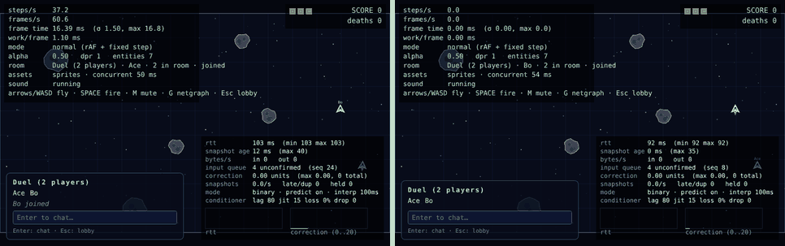
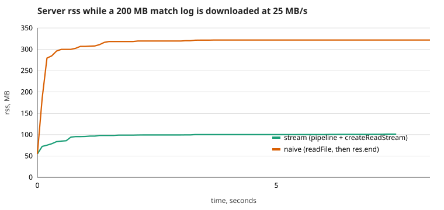

# Dogfight

A multiplayer-ready space dogfight built step by step in a JavaScript course (vanilla JS, ES
modules, Vite on the client, Node + `ws` on the server).

| Lab | Topic                                     | Tag      | Where to look                                                                         |
| --- | ----------------------------------------- | -------- | ------------------------------------------------------------------------------------- |
| 01  | Event loop, fixed-timestep game loop      | `lab-01` | [Lab 01](#lab-01--the-game-loop)                                                      |
| 02  | Objects, prototypes, `this`, composition  | `lab-02` | [Lab 02](#lab-02--the-entity-model)                                                   |
| 03  | Promises, async/await, loading, lobby     | `lab-03` | [Lab 03](#lab-03--asynchronous-javascript)                                            |
| 04  | Node.js: EventEmitter, streams, WebSocket | `lab-04` | [Lab 04](#lab-04--nodejs-eventemitter-streams-websockets)                             |
| 05  | Authoritative server, prediction, binary  | `lab-05` | [Lab 05](#lab-05--the-server-runs-the-game-prediction-reconciliation-binary-protocol) |

## Run

```bash
nvm use              # Node 22.18 or newer (see .nvmrc): runs .ts files by itself
npm install          # installs the workspaces (shared/, client/, server/) from the root

# development: TWO terminals
npm run dev:server   # terminal 1: game server on http://localhost:3000 (restarts on file change)
npm run dev          # terminal 2: Vite on http://localhost:5173, proxies /api and /ws to the server

# production-like: ONE process serves the built client and the API/WebSocket
npm run build        # client -> client/dist
npm start            # http://localhost:3000

npm test             # 202 tests (node:test) in all three workspaces, no browser needed
npm run typecheck    # tsc --strict over shared, server, client (and the tests): must print nothing
npm run lint         # ESLint (flat config) + eslint-config-prettier
npm run format       # Prettier
```

Experiments (each prints its result; the README quotes them):

```bash
npm run determinism       # Lab 01: fixed vs variable timestep, headless
npm run this-bug          # Lab 02: the `this` bug and its three fixes
npm run prototypes        # Lab 02: delegation / `this` / Map-vs-object / prototype chain
npm run puzzles           # Lab 03: four microtask/task ordering puzzles (5th: /puzzles.html)
npm run load-timing       # Lab 03: sequential vs concurrent loading
npm run event-loop-order  # Lab 04: nextTick / promise / timeout / immediate
npm run blocking-demo     # Lab 04: a 300 ms handler freezes every client
npm run error-crash       # Lab 04: 'error' without a listener, unhandled rejection
npm run rss-experiment    # Lab 04: 200 MB log, slow client, rss over time (writes docs/rss.*)
npm run tick-demo         # Lab 05: setInterval vs the target-time ticker
npm run wire-size         # Lab 05: the same snapshot as binary and as JSON
```

Controls: **← → / A D** rotate, **↑ / W** thrust, **Space** fire, **Enter** chat, **Esc** back to the
lobby, **M** mute, **G** netgraph (online; **R** restarts only the offline experiments). The HUD at the top left shows steps/s, frames/s, frame time
and CPU work per frame (Lab 01); the one at the top right shows score, hp, deaths and active pickup
effects. Add `?seed=123` to the URL to get the same asteroids and pickups every run.

## Structure

```
package.json                npm workspaces: shared, client, server; one lockfile, one ESLint/Prettier setup
shared/                     @dogfight/shared: the simulation, SAME code in browser and Node  (Lab 05)
  src/                      Game, World, Ship (integrate), entities, rng, arena, input (bits, DT),
                            snapshot.ts (world -> plain data), codec.ts (binary + JSON wire format)
  test/, scripts/           51 tests (determinism, codec, PvP, types); wire-size.mjs
client/                     everything that runs in the browser (Labs 01-03, plus the socket in Lab 04)
  index.html, vite.config.ts
  src/main.ts               wires loop + input + Game + rendering + lobby + room session
  src/loop.ts, input.ts     rAF + clamped accumulator; keyboard as a closure
  src/net/netgame.ts        prediction, reconciliation, interpolation, own bullets            (Lab 05)
  src/net/conditioner.ts    artificial lag / jitter / loss for game packets                   (Lab 05)
  src/render/netgraph.ts    rtt, snapshot age, bytes/s, input queue, correction on screen     (Lab 05)
  src/render/               canvas, interpolation, sprites, loading screen
  src/assets/               loader.ts (fetch/retry/abort/loadAll), chaos.ts (failure injection)
  src/net/connection.ts     WebSocket wrapper: send queue + reconnect with jittered backoff   (Lab 04)
  src/net/session.ts        RoomSession: roster, chat, join/rejoin protocol, events            (Lab 04)
  src/lobby.ts, src/ui/     lobby model (EventTarget) and the DOM for lobby, room panel, errors
  test/, scripts/, tools/   59 tests; experiments; dev helper plugin (?delay=, real 404s)
server/                     Node, ESM, TypeScript (types stripped by Node itself); dependencies: ws, zod                                      (Lab 04)
  index.ts                  entry: config, logger, signals (SIGINT/SIGTERM), last-resort handlers
  app.ts                    createApp(): http + ws + rooms + match logs; start()/stop() (testable)
  config.ts                 the ONLY reader of process.env; validates every value at start-up
  http.ts                   node:http routes, static files with a traversal guard, body limit
  rooms.ts                  Room / RoomManager extend EventEmitter (no sockets inside)
  protocol.ts               the wire protocol and server-side validation of every message
  ws.ts                     WebSocket lifecycle: join timeout, heartbeat, rate limit, slow clients;
                            binary game frames, JSON fallback, snapshots to every player      (Lab 05)
  ticker.ts, match.ts       30 steps/s at a target time; one authoritative Game per room      (Lab 05)
  ratelimit.ts              token bucket
  log/matchlog.ts, replay.ts  NDJSON Transform -> file; replay as async generator / HTTP stream
  scripts/, test/           five experiments; 92 tests (unit + real sockets + browser-less loopback)
docs/                       rss.svg + rss.csv (Lab 04 graph), two-windows.gif (Lab 05)
```

## Lab 06 — TypeScript for the protocol and the simulation

Same game, same behaviour (the determinism and loopback tests are unchanged and green), but now the
compiler checks it. **82 files** are `.ts`, `tsc` runs in `strict` mode with `noUncheckedIndexedAccess`,
`erasableSyntaxOnly` and `verbatimModuleSyntax`, and there is **no `any`** anywhere. Node runs the
`.ts` files by stripping the types (no build step for the server or the tests); Vite does the same
for the browser. `npm run typecheck` is the only thing that actually checks types, and CI runs it
(`.github/workflows/ci.yml`: typecheck, lint, format check, tests, build).

### What was done, in the order of the lab

- **`shared/` first.** `Vector2` fields are `readonly`. Snapshot entities carry a `kind` field
  (`'ship' | 'bullet' | 'asteroid' | 'pickup'`), so `switch (e.kind)` narrows to the right shape.
  `EntityId`, `Seq` and `Tick` are **branded** numbers (`shared/src/brand.ts`): an id cannot be passed
  where a sequence number is expected. Every `switch` over a `type` or `kind` ends in
  `default: return assertNever(x)`, so a new message type or event without a handler is a `tsc` error,
  not a silent no-op.
- **Zod at the door.** The messages are described once as Zod schemas (`shared/src/protocol.ts`) and the
  TypeScript types are _derived_ from them (`z.infer`), so schema and type cannot drift apart.
  `parseClientMessage(raw: unknown)` returns a result instead of throwing: a broken JSON frame is
  written to the log and the socket is closed with the same code as in Lab 04. The hand-written checks
  of Lab 04 are gone. The binary decoder checks length, ranges and the version byte itself
  (`DecodeError`).
- **Server and client under `strict`.** Room events are typed (`RoomEvents`), the environment config
  goes through a Zod schema, every `catch (error)` is `unknown` and is narrowed (`server/errors.ts`),
  and the browser's own events (`TypedEventTarget`, `GameEvents`) know their payloads.
- **`as` casts: 4**, each with a one-line comment next to it: the brand constructor (`brand.ts`), the
  `detail` of a `CustomEvent` that our own `emit()` created (`typed-target.ts`), the timer handle type
  (`ticker.ts`) and `server.address()` after `listen` (`app.ts`). Two `@ts-expect-error` lines remain
  in tests on purpose: they prove that writing to a `readonly` field does not compile.

### What TypeScript found

Types erase at run time, so data from the network is still checked at run time (Zod, `DecodeError`).
What the compiler caught while migrating, in code that had worked for weeks:

1. **A hole in the binary decoder.** The Lab 05 codec accepted a pickup record with type `9`. The
   renderer then did `PICKUP_STYLE[9].color` on `undefined` and the frame crashed. I reproduced it
   with the old code (it returns `type: 9`); the typed version has `PickupType = 'shield' | 'rapid' |
'homing'`, the decoder maps the byte through that list and throws `DecodeError('pickup type 9 out
of range')`.
2. **A comparison that could never be true.** `NetGame` checked `message.type === 'snap'`, a name
   that does not exist in the protocol (the real one is `'snapshot'`). Once `message` had a type
   (`ServerMessage`), `tsc` called it out; the code is now a `switch` with `assertNever`.
3. **Arrays that "are never empty".** `slice[0].seq` and `clockSamples[0].at` assumed an element
   exists. `noUncheckedIndexedAccess` makes `array[i]` of type `T | undefined`, and each place now says
   what happens when it is empty.

### Three types in plain words

- **Discriminated union** (`kind`, `type`, `alive`): a value is _one of several shapes_ and one
  field says which. After `if (own.alive)` the compiler knows `own.x` exists; before it, `own.x` is an
  error. It replaces "check the field and hope".
- **Branded type** (`Seq`, `Tick`, `EntityId`): at run time a plain number, at compile time a number
  with a sticky label. `ackSeq` (a `Seq`) cannot be compared with a `Tick` by accident.
- **`unknown`** instead of `any`: "I have a value and know nothing about it". `any` switches the checks
  off; `unknown` forces a check (`typeof`, `instanceof`, a Zod parse) before the value is used. Every
  byte from the network and every caught error starts as `unknown`.

### Framework or not

I kept the lobby, HUD and room panel as they are (plain DOM modules, now typed) and used **no**
framework. The game's heart is a canvas and a fixed-step loop that a framework does not touch, and the
DOM part is small (a room list, a callsign field, a chat box). A framework would add a build
dependency and a second way to do state without removing any code that hurts. It would start to pay off
if the UI grew screens with shared state (settings, friends, a match history).

## Lab 05 — the server runs the game: prediction, reconciliation, binary protocol

Two players now fly in ONE game. The browser sends **input** (thrust / turn / fire as four bits plus
a sequence number), never coordinates. Only the server computes the world, 30 steps per second,
and broadcasts snapshots.



_Two windows, `?lag=80&jitter=15` (RTT ≈ 100 ms): Ace shoots rocks, Bo flies. Each window shows its
own netgraph (bottom right): rtt, snapshot age, bytes/s, input queue, correction._

### What runs where

```
 browser                                          server (one Match per room)
 ───────                                          ───────────────────────────
 keys ─► bits + seq ─► [conditioner] ─► WebSocket ─► input queue per player
   │                                                    │ one input per tick (30/s)
   ├─► integrate()  (same code!)  = prediction          ▼
   │   pending[] = inputs not yet confirmed        Game.stepInputs(dt = 1/30)   ← @dogfight/shared
   ▼                                                    │
 draw own ship now                                      ▼ snapshot per player { tick, ackSeq, own, ships, … }
                 ◄─ [conditioner] ◄─ WebSocket ◄────────┘
 snapshot: own ship := server state, replay pending[]  (reconciliation, fade the error over ~100 ms)
           others: buffer, draw 100 ms in the past between two snapshots (interpolation)
```

- **`shared/`** (`@dogfight/shared`, an npm workspace): the whole simulation (`Game`, `World`, `Ship`,
  `integrate`, `codec`, `snapshot`). The same files are imported by the browser (Vite) and by Node.
  No DOM, no Node modules, no `Math.random()`, no `Date.now()`: ESLint enforces it
  (`no-restricted-properties`, `no-restricted-imports`) and a test greps for it.
- **Fixed dt = 1/30 s** on both sides (`TICK_HZ` in `shared/src/input.js`). The networked browser
  loop switches from 1/60 to 1/30 (`loop.setStep`), so one client step = one input = one server tick.
- **Determinism**: randomness only from the generator seeded by the server (`room.arena.seed`); entity
  ids are per `World` (not a global counter), so two worlds that do the same things agree on every id.
  Test: `the same inputs give the same ship in a Game and in the bare integrate() the browser uses`
  compares with `assert.equal` on `x, y, vx, vy, angle` — bit-for-bit, not "close".
- **Every input has a `seq`**; every snapshot has `tick` and `ackSeq` (the last input of THAT player the
  server has applied).
- **Why the client's coordinates are not accepted**: see the network note below.

### 30 steps/s without `setInterval` (`server/ticker.js`)

The ticker keeps the _target time_ of the next step (`next += period`) and sleeps only until it
(`setTimeout(next - now)`). A late step makes the next sleep shorter, so errors do not accumulate; after
a long freeze it runs at most 5 steps back to back and then skips the rest (resynchronises) instead of
fast-forwarding.

`npm run tick-demo` (10 s each, 2 ms of CPU work per step, Node 22):

| loop                       | steps/s   | note                                             |
| -------------------------- | --------- | ------------------------------------------------ |
| `setInterval(fn, 1000/30)` | **30.15** | 33.33 ms is rounded to whole ms: runs 0.5 % fast |
| `Ticker` (target time)     | **29.99** | mean lateness 0.7 ms, max 21 ms, 0 steps skipped |

`GET /health` shows the real rate of every running match (`matches.<room>.hz`, late, skipped, starved
inputs). A fake-clock unit test shows the drift of the naive loop and the skip/resync after a 3 s freeze.

### Stage 1 → stage 2: what prediction buys

Time from pressing ↑ to the own ship accelerating on screen (6 runs, headless Chromium, localhost;
`?lag=100` adds 100 ms of round trip):

| mode                      | press → ship moves                                             |
| ------------------------- | -------------------------------------------------------------- |
| `?predict=0` (stage 1)    | no lag: 63 ms (median)                                         |
| `?predict=0&lag=100`      | **162 ms** (129–163)                                           |
| prediction on, `?lag=100` | **29 ms** (12–47) — one 33 ms step, independent of the network |

Stage 1 waits for input → server tick → snapshot → network (≈ RTT + up to two ticks): clearly felt at
100 ms. With prediction the key is applied in the next client step by the same `integrate()`.

### Prediction and reconciliation (`client/src/net/netgame.js`)

Every client step: `seq++`, push `{seq, bits}` to `pending`, `own = integrate(own, bits, DT)`, send.
On a snapshot: drop `pending` up to `ackSeq`; `state = snapshot.own` (float64, exact); replay the rest
of `pending` on it. The difference between the old predicted position and the new one is the
**correction**. It is not drawn at once: the ship is _placed_ at the new state, and a render offset
`-(correction)` fades with a time constant of 33 ms (≈ 95 % gone after 100 ms). A correction above
120 units (respawn, collision knock) is a teleport and is not smoothed.

**The `Math.random()` experiment** (`?noise=8` puts `Math.random()` into `integrate` in the _browser
only_, via `physicsHooks.afterIntegrate`; the server stays deterministic). 8 s of flying, `?lag=100`:

| physics                        | corrections (of ~260 snapshots) | mean / peak correction |
| ------------------------------ | ------------------------------- | ---------------------- |
| deterministic (no noise)       | **0**                           | 0 / 0                  |
| `Math.random()` in `integrate` | **260** (every snapshot)        | 0.5 / 3.6 units        |

Removed again → back to 0 (`server/test/loopback.test.js` runs both). The lesson: reconciliation is only
"free" when browser and server compute _exactly_ the same thing; every difference is paid as a
visible correction. Corrections also appear for real reasons the browser cannot predict: another
player's bullet, a collision with a rock (the server pushes the ship away), a pickup.

### Other ships: interpolation (entity interpolation)

Other players, rocks, pickups and other players' bullets are drawn **100 ms in the past**, between the
two snapshots that surround that moment (wrap-aware, shortest-way angle). The server clock is
estimated as `arrival − tick·33.3 ms`, with a **minimum filter over the last 2 s** (the least-delayed
packet tells the truth about the clock). Own bullets are shown immediately (predicted, with the
`seq` that fired them); when the server's copy of the bullet arrives it takes over, moved forward by the
time the server has not seen yet.

### Binary protocol (`shared/src/codec.js`) vs JSON

`ArrayBuffer` + `DataView`; **little-endian** on every call (the order is written down, not "whatever the
CPU does"); byte 0 = format version, byte 1 = message type. Angles are `Int16`
(−π…π over −32767…32767), positions of _other_ entities are `Uint16` over the arena (0.02 units per
step), velocities `Int16`; the **own ship is sent as float64**, because the browser replays inputs from it
and an exact copy makes the replay bit-identical. `?format=json` switches both directions to JSON text
for comparison (`npm run wire-size`):

| message (typical Duel room: 2 ships, 5 rocks, bullets, ~10 entities) | binary | JSON   | JSON / binary |
| -------------------------------------------------------------------- | ------ | ------ | ------------- |
| snapshot, bytes                                                      | 172    | 1379   | ×8.0          |
| snapshots at 30/s, bytes/s per player                                | 5 168  | 41 362 | ×8.0          |
| input packet (newest + 7 redundant inputs), bytes                    | 15     | 66     | ×4.4          |
| inputs at 30/s, bytes/s                                              | 450    | 1 980  | ×4.4          |

Measured in the browser (netgraph, 2 players, idle network): **3.5 KB/s in** with binary, **25 KB/s in**
with JSON.

Layouts (all little-endian):

```
input   u8 version | u8 type=1 | u32 firstSeq | u8 count | u8 bits × count      (bits: 1 left, 2 right, 4 thrust, 8 fire)
ping    u8 version | u8 type=2 | f64 clientTime                                  → pong: type=2, f64 t, u32 tick
snapshot u8 version | u8 type=1 | u32 tick | u32 ackSeq
         own:   u8 alive, [f64 x, y, vx, vy, angle, u8 thrust, u16 cooldownMs, u8 hp, shield, rapid, homing, invuln],
                u32 score, u16 deaths, u8 respawn
         u8 n + n × ship     { u8 slot, u16 x, u16 y, i16 angle, u8 flags, u8 hp }          9 bytes
         u8 n + n × bullet   { u16 id, u16 x, u16 y, i16 vx, i16 vy, u8 slot, u16 fireSeq, u8 flags }  14 bytes
         u8 n + n × asteroid { u16 id, u16 x, u16 y, u8 size|hunter<<4 }                    7 bytes
         u8 n + n × pickup   { u16 id, u16 x, u16 y, u8 type }                              7 bytes
         u8 n + n × event    { u8 kind|param<<4, u16 x, u16 y }                             5 bytes
```

The server never trusts a frame: wrong version, unknown type or a length that lies → the socket is
closed with `1003`; more than 64 bytes → `1009`; a frame before `join` → `1008` (all tested).

### Losing, delaying and reordering packets (`?lag= &jitter= &loss=`)

`client/src/net/conditioner.js` sits between the socket and the game, for game packets only, in both
directions: `lag` = added round trip (each way waits lag/2), `jitter` = extra random 0…N ms per packet
(packets get independent delays, so they arrive **out of order**), `loss` = % of packets dropped.
Because a WebSocket is TCP (it never loses or reorders), this is the only way to see what a UDP-like
link would do.

What the game does about it:

- **Input loss**: every packet repeats the last 8 inputs; the server ignores duplicates (`seq ≤ last`)
  and fills a gap that the repeats did not cover with the previous bits. With 30 % of input packets
  dropped over 600 ticks the server starved 25 times at most and the predicted ship stayed within
  40 units of the server's (`loopback.test.js`).
- **Snapshot loss / reordering**: a snapshot with a `tick` not newer than the last one is ignored
  (counted as `late/dup` in the netgraph); a lost snapshot only makes the next picture 33 ms older.
- **Server input queue**: one input per tick; empty → the last input is repeated (`starved`);
  more than 6 waiting → the oldest are dropped (a client cannot move faster by sending more than 30
  inputs/s). Game traffic has its own rate-limit bucket (90/s, burst 180).

### Network note

**Latency.** The speed of light and the routers cost 20–200 ms, and no code removes it. What the code can
do is hide it _for the one thing the player controls_ (prediction: the ship answers in ≈ 30 ms whatever
the RTT is) and smooth it for everything else (interpolation: a steady picture that is 100 ms old).
Everything else on screen is therefore in the past and the own ship is in the future of the server;
you aim at where others _were_, and the server decides hits on its own, older, world.

**Divergence of state.** Two computers never agree "by themselves": inputs arrive late, get lost, the
server applies a different number of them, a physics function has one `Math.random()`. The cure is not
to keep them identical but to make one of them the truth: the server's state wins, the browser takes it
at every snapshot and re-applies what the server has not seen. The size of the daily disagreement is
the `correction` in the netgraph: 0 with deterministic physics, 0.5 units average with noise. Events
the browser cannot know (somebody else's bullet) are corrections it cannot avoid.

**Cheating.** The browser is the player's, not ours: anybody can edit JavaScript, so everything the
client says is a _claim_. If the client sent coordinates it could teleport, fly at any speed or fire without
cooldown; with an authoritative server the client can only say "I am holding thrust", and the server runs
the real physics, the real cooldown and the real collisions. The server also validates frame size,
version and type, rate-limits inputs, caps the input queue (no speed-hack by sending more inputs), and
does not send the client anything it should not know. What it cannot stop: aimbots and wallhacks
(the client does see other ships), and a client that lies about its own latency. Prediction is safe
because it is only a _guess_ the server overrides.

**Interpolation delay: 100 ms.** Snapshots come every 33 ms; to draw between two of them the render time
must be at least one interval behind, and to survive a late or lost snapshot at least two or three.
Measured: how many of ~480 frames in 8 s had to _freeze_ others because there was no snapshot ahead of the
render time (`held` in the netgraph; `?lag=80&jitter=50&loss=3`):

| `?delay=`   | 33 ms (1 interval) | 67 ms (2) | **100 ms (3)** | 150 ms (4.5) |
| ----------- | ------------------ | --------- | -------------- | ------------ |
| held frames | 304                | 17        | **3**          | 0            |

100 ms is the knee: below it the picture stutters on a bad network, above it others are further in the
past for nothing. It is a trade between smoothness and how stale other players look, and it is a flag
(`?delay=`) because the right value depends on the player's connection.

### Try it

```bash
npm install && npm run build && npm start      # http://localhost:3000, open it in TWO windows, join "Duel"
```

| URL flag                    | what it does                                             |
| --------------------------- | -------------------------------------------------------- |
| `?predict=0`                | stage 1: the own ship moves only after a snapshot        |
| `?interp=0`                 | draw the newest snapshot as it is (others jump)          |
| `?delay=100`                | interpolation delay in ms                                |
| `?format=json`              | JSON frames instead of the binary protocol               |
| `?lag=100&jitter=30&loss=5` | artificial round trip (ms), jitter (ms), loss (%)        |
| `?noise=8`                  | `Math.random()` inside `integrate` (browser only)        |
| `?graph=0` / key **G**      | hide / show the netgraph                                 |
| `?debug=1`                  | `window.dogfight` for the console (`dogfight.net.stats`) |

Commands: `npm run tick-demo` (setInterval vs ticker), `npm run wire-size` (JSON vs binary sizes).

## Lab 04 — Node.js: EventEmitter, streams, WebSockets

The game now has a **server**. It keeps the list of rooms, lets players join and leave, relays chat,
writes every room's history to disk and shuts down cleanly. Ship coordinates are _not_ sent yet
(Lab 05): the server only knows who is in which room. The client from Labs 01-03 stays as it was;
its lobby now reads the real `GET /api/rooms`, and **Join** opens a WebSocket.

```
browser ── GET /api/rooms ─────────────┐
   │                                   ▼
   │  ws://…/ws  (JSON, v1)      ┌── server/index.js ── config.js (env, validated)
   └────────────────────────────►│     app.js ── http.js   routes + static files
                                 │             └ ws.js     sockets: join timeout, heartbeat, limits
                                 │             └ rooms.js  Room / RoomManager (EventEmitter)
                                 └─ rooms emit events ──► ws.js (broadcast) + log/matchlog.js (NDJSON file)
```

### Try it (two windows)

```bash
npm run dev:server        # terminal 1
npm run dev               # terminal 2, open http://localhost:5173 in TWO windows
```

Pick a callsign and a room in both windows; each sees the other in the roster, chat with **Enter**,
**Esc** goes back to the lobby. To see reconnect: stop the server (Ctrl+C), watch the yellow
"Connection lost. Reconnecting in …" banner, type a message (it is queued), start the server again.
Everything the server wrote is in `server/logs/*.ndjson`; `GET /api/replays` lists them.

### What was built, milestone by milestone

**M1 - HTTP, config, shutdown** (`server/http.js`, `config.js`, `index.js`)

- Plain `node:http`, no framework. `GET /health`; `GET`/`POST /api/rooms` (JSON validated field by
  field, 400 lists every problem; 415 wrong content type; 413 body over `MAX_BODY_BYTES`; 405 with
  `Allow`). Everything else under `/api/` is a JSON 404. The built client is served from
  `client/dist` with correct MIME types.
- **Path traversal**: `..` (also `%2e%2e`, double-encoded, `\`, NUL) is rejected _before_ the disk
  is touched, and the resolved path must still start with the static root. Tested with raw sockets,
  because `fetch` normalises `..` away before sending.
- **Config**: `config.js` is the only file that reads `process.env`. Every value has a parser and a
  range; a bad value stops the server at start-up with _all_ problems listed (`PORT: "30o0" is not a
whole number`), not at 3 a.m. `npm run dev:server` uses `--env-file`, `npm start` an optional
  `server/.env`.
- **Graceful shutdown**: SIGINT/SIGTERM -> stop accepting, close every socket with 1001, close rooms,
  wait until every match log is flushed, exit with code **0** (tested by spawning the real process).
  A second signal exits immediately.

**M2 - rooms, protocol, WebSockets** (`rooms.js`, `protocol.js`, `ws.js`, `client/src/net/`)

- `Room extends EventEmitter` and knows nothing about sockets: `join`/`leave`/`chat` change the
  roster and _emit_ `joined`, `left`, `chat`, `empty`. `RoomManager` deletes a room when it becomes
  empty (a room created over HTTP that nobody joins is removed after `ROOM_IDLE_MS`). `ws.js`,
  the match log and the tests are all just listeners.
- **Protocol v1** (`protocol.js`), JSON text frames `{ "v": 1, "type": …, … }`:

  | direction | type      | fields                 | notes                                                  |
  | --------- | --------- | ---------------------- | ------------------------------------------------------ |
  | c -> s    | `join`    | `room`, `name`         | must come within 5 s of connecting                     |
  | c -> s    | `chat`    | `text` (1-300)         |                                                        |
  | c -> s    | `leave`   |                        | leaves the room, socket stays open                     |
  | s -> c    | `welcome` | `id`, `limits`         | right after connecting                                 |
  | s -> c    | `joined`  | `room` (with arena), … | the client starts the game now                         |
  | s -> c    | `roster`  | `players`              | someone came or went                                   |
  | s -> c    | `chat`    | `from`, `text`, `at`   |                                                        |
  | s -> c    | `error`   | `code`, `message`      | recoverable (room full, name taken): socket stays open |

- **Every incoming message is validated** (`parseClientMessage`): binary frame, size in _bytes_,
  JSON syntax, object shape, version, `type` (looked up with `Object.hasOwn`, so `"constructor"` is
  not a type), then each field. Unknown type / wrong shape -> close **1008**; not JSON -> **1007**;
  binary -> **1003**; too big -> **1009** (set by `ws` itself through `maxPayload` before the message
  is even parsed). Extra fields are dropped, so a client cannot smuggle `admin: true` through.
- **Join timeout** 5 s -> close 4001. **Heartbeat**: one timer pings everybody every 15 s; a socket
  that missed two pongs is `terminate()`d (a closed laptop lid is invisible to TCP for minutes).
- Every socket gets `ws.on('error', …)` as its **first** listener (see "crash and fix").
- **Client** (`net/connection.js`): a `WebSocket` wrapper with a **send queue** (messages written
  while offline go out, in order, after the next connect; capped at 50, oldest dropped) and
  **reconnect** with exponential backoff and jitter (`500 ms * 2^n`, capped at 15 s, "equal
  jitter" so the delay is never 0 and a restarted server is not hit by everyone at once). Closes that
  mean "you sent something wrong" (1003/1007/1008/1009) are _not_ retried. `net/session.js` re-sends
  `join` after every reconnect and copes with the server still holding the old socket
  (`name_taken` -> retry, instead of an error). Typing in the chat box never steers the ship.
- The DOM is built with `textContent` only: `` in chat is shown as text.

**M3 - match log as a stream pipeline** (`log/matchlog.js`, `log/replay.js`)

- `events -> Transform (objects in, "line\n" out) -> fs.WriteStream`, joined by `stream.pipeline`.
  Every room gets a log (`room_created`, `joined`, `left`, `chat`, `room_closed`), flushed when the
  room is removed or the server stops. `write()` returns `false` when the buffer is full;
  `drained()` waits for the file (the experiment below hit that 3541 times for 220 MB).
- **Replay** is the same idea backwards: `createReadStream -> parser Transform (lines -> objects)`,
  exposed as an **async generator** (`for await (const event of replayEvents(file))`), and over HTTP as
  `GET /api/replays/:id`, which is just `pipeline(createReadStream(file), res)`. A corrupt line makes
  the iterator throw instead of hanging.

**M4 - abuse controls** (`ratelimit.js`, `ws.js`, `http.js`)

| Threat                       | Control                                                                                         | Where               |
| ---------------------------- | ----------------------------------------------------------------------------------------------- | ------------------- |
| message flood                | token bucket, 10 msg/s, burst 20 -> close 1008                                                  | `ratelimit.js`      |
| giant frame                  | `maxPayload` 2 KB (ws closes with 1009)                                                         | `ws.js`             |
| giant HTTP body              | `Content-Length` checked early, running total checked too; 413; at most `limit` bytes ever held | `http.js`           |
| silent / dead connection     | join timeout 5 s, heartbeat, 2 missed pongs                                                     | `ws.js`             |
| too many connections / rooms | 200 sockets (close 1013), 50 rooms, room size, unique callsign                                  | `ws.js`, `rooms.js` |
| slow reader (2G phone)       | `bufferedAmount`: above 64 KB skip droppable chat, above 256 KB terminate                       | `safeSend`          |
| path traversal               | rejected before the disk, plus "still inside the root" check                                    | `http.js`           |
| slow-loris headers           | `headersTimeout` 10 s                                                                           | `app.js`            |

### Event loop

`npm run event-loop-order` (Node 22, Linux):

```
1. sync > nextTick > promise > queueMicrotask > setImmediate > setTimeout
2. setTimeout(0) vs setImmediate from the MAIN module, 200 fresh processes:
   timeout first 9 times, immediate first 191 times  -> not deterministic
3. the same pair inside an I/O callback, 200 runs: immediate first 200 of 200 -> deterministic
```

`nextTick` and promise callbacks run between phases, before the loop moves on; `nextTick` is drained
before promise jobs. From the main module the order of `setTimeout(0)` and `setImmediate` depends on
whether 1 ms had passed by the time the loop started. Inside an I/O callback (poll phase) the next
phase is _check_, where `setImmediate` runs, so it always wins.

**What if an HTTP handler takes 300 ms of CPU?** `GET /api/slow` (dev only, `ENABLE_SLOW_ROUTE`)
spins for 300 ms. `npm run blocking-demo`: 8 clients ask `GET /health` every 50 ms for 3 s, from a
_separate process_ (clients in the server's own thread would freeze with it and see nothing):

| run                                          | requests | p50    | p99        | max        |
| -------------------------------------------- | -------- | ------ | ---------- | ---------- |
| quiet                                        | 471      | 0.9 ms | 16.4 ms    | 19.1 ms    |
| a client also calls the blocking route (4 x) | 336      | 1.6 ms | **279 ms** | **280 ms** |
| same 300 ms as `await sleep(300)`            | 456      | 1.7 ms | 45 ms      | 57 ms      |

JavaScript runs on one thread, so while a handler computes, _nobody_ is served - not `/health`, not
chat, not the heartbeat (a long enough freeze makes healthy clients look dead and get terminated).
Waiting is free (`await`); computing is not. CPU-heavy work belongs in a worker thread or another
process. (The 3 s runs are short, so p99 of the last two rows is noisy; the maximum of the blocking
row is the point.)

### Backpressure: memory while a slow client downloads a 200 MB log

`npm run rss-experiment` writes a 221 MB log through the Transform pipeline (waiting for `drain`
3541 times; rss stayed at 78-103 MB), then serves it to a client that reads 25 MB/s, two ways, each in
its own process, rss sampled every 100 ms:



| way                                     | time  | rss start -> max     | after the first second                 |
| --------------------------------------- | ----- | -------------------- | -------------------------------------- |
| `pipeline(createReadStream(file), res)` | 7.5 s | 54.9 -> **101.3** MB | flat (95.7 -> 101.3, +5.6 MB in 6.5 s) |
| `res.end(await readFile(file))`         | 8.2 s | 54.8 -> **321.8** MB | flat at the file size + overhead       |

The streaming curve is **flat**: the first second is process warm-up (about 40 MB: V8 heap, HTTP
buffers), then it moves by a few MB while 200 MB passes through. The naive curve jumps by the size
of the file before the first byte leaves and stays there, _per download_: ten slow clients would
need 2 GB. `pipeline` does the bookkeeping: `res.write()` returning `false` pauses the file reader
until `drain`, so at most one 64 KB chunk plus the socket buffers are in flight, and if the client
disconnects, both streams are destroyed and the file descriptor is closed. (Raw data in
`docs/rss.csv`; the client of the experiment lives in the same process as the server's end of the
socket, which is why the absolute numbers include a little client overhead.)

### Crash and fix: `'error'` without a listener

`npm run error-crash` runs each case in a child process:

```
# emit('error') with NO listener           exit code 1   Error: socket exploded
# emit('error') WITH a listener            exit code 0   handled: socket exploded / still alive
# rejected promise nobody awaits           exit code 1   Error: disk full
# …with a process 'unhandledRejection'     exit code 1   logged: disk full
```

`EventEmitter.emit('error')` is special: with no `'error'` listener it **throws** the error from
`emit()`, and a throw nobody catches ends the process. Sockets, streams and rooms are all emitters,
so one flaky client (reset connection, bad frame) whose socket has no `'error'` handler would take
every room down. The Promise twin is a rejected promise nobody awaits: since Node 15 that is also a
crash. What the server does about it:

- `ws.on('error', …)` is the first listener of every socket (`server/ws.js`) and there is a test that
  emits an error on a live socket and checks the server keeps working;
- every `ws.send` has a callback, and a failed send terminates only that socket;
- `pipeline` is used instead of bare `.pipe()` (which does not forward errors or clean up); the match
  log's `done` promise always has a `.catch`;
- as the last line of defence `index.js` logs `uncaughtException` / `unhandledRejection` and exits
  with 1: after an unknown exception the process state is unknown, so the honest move is to let a
  supervisor restart it, not to keep serving.

**Bugs found while building this (and kept as tests)**

- The shutdown timers were `unref()`ed, so after the HTTP server closed there was nothing left to keep
  the process alive: it exited with code 0 _in the middle of_ flushing the logs and never printed
  "bye". Those two timers must keep the loop alive. (`test/process.test.js`.)
- `readBody` destroyed the request on an oversized upload, which also killed the socket, so the client
  got a connection error instead of `413`. Now it stops collecting at the limit, answers 413 and closes
  the connection afterwards. (`test/http.test.js`, the chunked-upload test.)
- `fetch` and the browser normalise `..` out of a URL, so traversal tests that use them prove nothing;
  they send raw request lines through `net.connect`.

### Tests

`npm test`: **170** (client 100, server 70). The server tests use no mocks for the interesting
parts: a real server on port 0 in a temp directory, real `ws` clients, and real child processes for
signals and bad config. Highlights: validation of every kind of bad message and the close code it
earns; join timeout (4001), heartbeat with a client that never pongs, rate limit, `maxPayload`,
connection cap, name taken / room full leave the socket open, an emitted socket `'error'` does not
crash, graceful shutdown (1001 for clients, complete log on disk, exit code 0 for SIGINT and
SIGTERM), config errors listed together, path traversal over raw sockets, chunked body cap, log
round-trip and replay of lines cut at arbitrary chunk boundaries. The client tests drive
`Connection`/`RoomSession` with a fake WebSocket: queue order, handshake first, backoff values with
a fixed random, no retry for 1008, retry for 1001/1006, stale events of a replaced socket ignored.

### Defence (5 minutes)

1. `npm run build && npm start`, open `http://localhost:3000` in two windows; join the same room;
   chat both ways; Esc in one window and watch the roster change in the other.
2. Ctrl+C in the server terminal: it prints `shutting down`, `bye`, exit code 0; the log file is in
   `server/logs`.
3. Show `docs/rss.svg` and say why the green line is flat; show `npm run error-crash`.

### Not done (stretch goals)

Gzip of the log, an SSE spectator endpoint and a Fastify port were not attempted.

## Lab 03 — asynchronous JavaScript

The game no longer starts instantly. It **loads** (manifest → sprites, sounds, arena config, with a
real progress bar), shows a **lobby** (room list polled from `/api/rooms`), and only then starts a
local match with the chosen room's arena settings. Everything that waits goes through Promises /
`async`/`await`, and every wait can be cancelled.

> Since Lab 04 the browser code lives in `client/`: read every path in this section as
> `client/<path>`. `/api/rooms` is no longer a static JSON; it comes from the real server.

### Flow

```
boot() ─ fetch manifest (withRetry) ─ loadAll (Promise.all, progress bar) ─ lobby ─ Join ─ game
                                         │ fails          │ rooms unreachable
                                         ▼                ▼
                                   Retry button      "Retrying automatically…" + Retry now
```

### Where things are

| File                         | Job                                                                               |
| ---------------------------- | --------------------------------------------------------------------------------- |
| `src/assets/loader.js`       | `fetchJson` (checks `ok`), `loadImage/Audio/Json`, `withRetry`, `loadAll`         |
| `src/render/loading.js`      | canvas loading screen, eased real progress                                        |
| `src/render/sprites.js`      | sprite sheet + atlas, `drawImage` with a source rect                              |
| `src/audio.js`, `src/hud.js` | Web Audio and HUD; they **listen** to game events                                 |
| `src/lobby.js`               | `class Lobby extends EventTarget`: no DOM, tested in Node                         |
| `src/ui/*.js`, `ui.css`      | the DOM for lobby and retry screens                                               |
| `tools/dev-api.js`           | Vite plugin: `?delay=N`, real 404s for `/assets/*` (rooms API moved to `server/`) |
| `public/assets/…`            | manifest, sprites, sounds, arena config (generated by `tools/make-assets.py`)     |

### Decisions

- **`fetch` does not reject on 404/500.** One `fetchJson` wraps it and throws `HttpError` when
  `!response.ok`; every loader goes through it.
- **Retry policy (`withRetry`).** Exponential backoff with full jitter. It retries only _transient_
  errors: 5xx, timeouts, network errors. It never retries 4xx (the file is not going to appear),
  aborts, or corrupt JSON (`SyntaxError`).
- **Cancellation.** One `AbortSignal` per load; each request also gets `AbortSignal.timeout(4000)`
  combined with `AbortSignal.any`. If a required asset fails, its siblings are aborted too.
- **Per-asset policy in the manifest:** `onError: "fail" | "fallback" | "skip"`. The sprite sheet is
  `fallback` (the game draws vector shapes), arena config is `fallback` (defaults), sounds are `skip`.
- **Audio.** Sounds are downloaded and decoded _during loading_ with an `OfflineAudioContext`
  (no gesture needed). The real `AudioContext` is created on the first click/key, because browsers
  block audio before a user gesture. The Join click is that gesture.
- **The simulation never imports audio.** `Game.events` is an `EventTarget`; the game dispatches
  `CustomEvent("fired" | "hit" | "exploded" | "collected")` with plain-data `detail`. `audio.js` and
  `hud.js` subscribe from `main.js`. Delete both and the sim and its tests are unchanged
  (`test/events.test.js`).
- **Lobby.** `refresh()` never rejects; it reports through events (`status`, `rooms`). A sequence
  number discards a late answer from an older request, and the previous in-flight request is
  aborted. Polling is a chain of `sleep`s (not `setInterval`), so requests never overlap.
  `join()` stops polling, which aborts anything in flight (no leaked timers after leaving).
  The lobby keeps showing the last good list when a refresh fails.

### Sequential vs concurrent loading

`npm run load-timing` (7 assets, +300 ms latency per request, median of 5 runs, real HTTP):

| mode                         | Node    | Chromium (`?load=sequential`) |
| ---------------------------- | ------- | ----------------------------- |
| sequential `await` in a loop | 2124 ms | 2143 ms                       |
| `Promise.all`                | 312 ms  | 611 ms                        |

Sequential ≈ the **sum** (7 × 300). `Promise.all` ≈ the **slowest**. In the browser concurrent is
~2×300, not 1×300: Chromium opens at most **6 connections per host** over HTTP/1.1, so the 7th
request waits for a free slot. I checked it directly: 5 parallel requests → 311 ms, 6 → 316,
7 → 615, 8 → 616, 12 → 622.

Try it: `?latency=300` (adds delay to every asset) and `?load=sequential`.

### Five ordering puzzles

Each prediction was written before running (`npm run puzzles`; #5 in the browser at `/puzzles.html`).

**1.** `log('A'); Promise.resolve().then(B).then(C); queueMicrotask(D); log('E')`
→ **A E B D C**. Sync code first. Then the microtask queue is FIFO: B and D were queued before C,
because C is queued only after B finishes.

**2.** `async f(){ log('f1'); await g(); log('f2') }` with `g` logging `g1`; then
`Promise.resolve().then(p1).then(p2); log('sync')`
→ **f1 g1 sync f2 p1 p2**. `f` runs synchronously up to the `await`; the rest of `f` is a
microtask queued before `p1`.

**3.** `setTimeout(T1); Promise.resolve().then(()=>{M1; setTimeout(T2)}).then(M2); setTimeout(T3); log('S')`
→ **S M1 M2 T1 T3 T2**. All microtasks (even chained ones) drain before the next task. T2 was
scheduled later than T1 and T3, so it runs last.

**4.** `async a(){return 1}`, `async b(){return Promise.resolve(2)}`, plus a three-step `.then` chain
→ **a 1, t1, t2, b 2, t3**. Returning a promise from an async function costs two extra microtask
ticks (the promise is adopted via a thenable job), so `b` is later than `t2`.

**5.** (browser) `setTimeout(timeout); rAF(raf → microtask in raf); rAF(raf 2); .then(microtask); sync`
→ **sync, microtask**, then `raf → microtask in raf → raf 2` (each rAF callback gets its own
microtask checkpoint). Whether `timeout` runs before or after `raf` is **not specified**: they
are different task sources. I saw both: raf first 9 of 12 runs in one batch, 16 vs 14 of 30 in
another. Lesson: never rely on that order.

### Failure gallery

Reproduce with `?chaos=` (dev only; `?chaos=404,json` combines). Failures are injected on the first
attempt only, so Retry really works.

| URL              | What breaks                | What the player sees                                                                                      |
| ---------------- | -------------------------- | --------------------------------------------------------------------------------------------------------- |
| `?chaos=404`     | sprite sheet is a real 404 | Game starts with vector shapes; HUD says `fallbacks: sprites`. No retry (4xx).                            |
| `?chaos=json`    | arena config is corrupt    | Game starts with the default arena; no retry (`SyntaxError`).                                             |
| `?chaos=timeout` | an asset hangs             | Retried once; if it still fails: "Could not load the game" + **Retry** button.                            |
| `?chaos=abort`   | load is cancelled mid-way  | "Reason: cancelled" + **Retry**; the retry loads normally.                                                |
| `?chaos=rooms`   | `/api/rooms` times out     | Lobby: "Server not responding (timed out). Retrying automatically…" + **Retry now**; recovers on its own. |

All five were run in headless Chromium: no uncaught errors, the game starts in 404/json/rooms, and
Retry leads to the lobby in timeout/abort. Screenshots go in `docs/` when you run them yourself.

### Dev-server notes

- `?delay=N` on any URL slows that response (loading-bar demo).
- Vite's SPA fallback answers `200 index.html` for missing files, so a "missing sprite" would not be
  a 404. `dev-api.js` turns missing `/assets/*` into real 404s.
- A Vite `configureServer` hook must **not return** anything (a returned function is a post hook;
  `middlewares.use()` returns the app, which crashed startup).

### URL switches

`?seed=N` · `?latency=N` · `?load=sequential` · `?chaos=404,json,timeout,abort,rooms` ·
`?exp=block|interval|variable` (Lab 01) · `&autopilot=1` (skip loading and lobby, vector art).
Keys: **Esc** back to the lobby, **M** mute.

## Lab 02 — the entity model

One ship became a world: ships, bullets, asteroids, pickups and explosions, an entity manager,
collisions, shooting, respawn and a score. Inheritance stays one level deep; everything else is
composed.

### The game

- Fly, shoot with **Space**. Asteroids come in sizes 1–3 (hp = size); small ones are sometimes
  _hunters_ that slowly steer toward you. Ships have 3 hp and are invulnerable for 1.5 s after a hit.
- A destroyed ship explodes into particles and respawns after 2 s at a random safe spot, protected
  for 2 s. Score: 50 × size for every asteroid destroyed by a bullet.
- Pickups (stationary rings, collected by flying into them): **S** shield, **R** rapid fire (8 s each),
  **H** homing bullets (10 s).

### Class tree (one level, on purpose)

```
Entity            id (private static counter), pose, vel, radius, kind, alive, behaviors[], update()
├── Ship          private #hp + `get hp()`, fire(), effects: Map<name, secondsLeft>
├── Bullet        ttl, damage, ownerId
├── Asteroid      size, hp, optional `homing` behavior
├── Pickup        stationary + collidable, apply(collector)
└── Explosion     a burst of short-lived particles
```

### The `this` bug (encountered on purpose, then fixed)

`Ship.fire()` reads `this` (cooldown, pose, world). It works as `ship.fire()` because the call site
puts the ship to the left of the dot (implicit binding). Inside the game it is always called that
way (`this.fire()` from `Ship.update`), so the bug only appears when someone wires it up naively:

```js
canvas.addEventListener('click', ship.fire); // passes the function, loses the ship
```

`npm run this-bug` reproduces it (and `test/entities.test.js` pins it down):

| Call site                       | `this` inside `fire`                     | What happens                                                       |
| ------------------------------- | ---------------------------------------- | ------------------------------------------------------------------ |
| `const f = ship.fire; f()`      | `undefined` (class bodies are strict)    | `TypeError: Cannot read properties of undefined (reading 'alive')` |
| DOM listener (`f.call(canvas)`) | the element                              | **silently** returns `null`, no bullet                             |
| `setTimeout(ship.fire, 0)`      | `Timeout` in Node, `window` in a browser | **silently** returns `null`, no bullet                             |

The silent variants are the dangerous ones: no error, the ship just stops shooting.

Three fixes, with what each one costs (all measured in `npm run this-bug`):

| Fix                        | Code                   | Downside                                                                                                                                                                                    |
| -------------------------- | ---------------------- | ------------------------------------------------------------------------------------------------------------------------------------------------------------------------------------------- |
| Wrapper arrow              | `() => ship.fire()`    | a new function each time you write it (keep the reference if you need `removeEventListener`)                                                                                                |
| `bind`                     | `ship.fire.bind(ship)` | creates a new function on every call (`bind(x) === bind(x)` is `false`); permanently tied to that one object                                                                                |
| Arrow function class field | `fire = () => { … }`   | one function per instance (`a.fire !== b.fire`), not on the prototype (`Ship.prototype.fire` is `undefined`), so a subclass cannot `super.fire()` and it cannot be stubbed on the prototype |

**Chosen: the wrapper arrow, resolving the ship at call time**, e.g.
`() => game.ship?.fire()`. In this game the ship _object_ is replaced on every respawn
(`game.ship` is a new `Ship` after each death). A `bind(ship)` or an arrow field captured at start-up
would keep pointing at the dead ship and silently stop shooting after the first death; the wrapper
looks up the current ship each time. It also keeps `fire` as one shared method on the prototype.

### Design note: composition instead of a deep hierarchy

The two features that break a class tree: **(a)** _homing_ that can steer a bullet or an asteroid,
**(b)** a _pickup_ that is stationary and collidable but is not a ship.

**The inheritance version I did not build.** `Bullet → HomingBullet` and
`Asteroid → HomingAsteroid` copy the same steering code; hoisting it into a shared parent needs a
class that is both a "projectile" and a "rock" (an asteroid is not a projectile), or puts homing into
`Entity` so every entity carries it. JavaScript has single inheritance, so "homing + shielded +
rapid" would need a class per combination (kinds × capabilities). And the pickup would have to
extend `Ship` (inheriting hp, `fire()` and input handling it never uses) or re-implement position,
radius and collision.

**What I built instead.**

- `Entity` keeps only what every entity really shares: id, pose, velocity, radius, `kind`, `alive`
  and `update()`. One level of `extends`, no more.
- Capabilities are **behavior objects** `{ name, update(entity, dt, world) }` kept in
  `entity.behaviors`. `homing({ targetKind, turnRate, range })` is a single function that steers
  whatever it is attached to. Hunter asteroids get it at construction; a bullet gets it in
  `Ship.fire()` while the _homing_ effect is active. One behavior, two kinds of entity
  (`test/world.test.js`: "homing steers one behavior object onto BOTH a bullet and an asteroid").
  Ships run their behaviors too (even though `Ship.update` does not call `super.update()`).
- `Pickup` is its own `Entity` subclass: `update()` only counts down its time-to-live, it is `solid`,
  and when a ship touches it, `pickup.apply(ship)` calls `ship.addEffect(type, seconds)`
  (duck-typed: anything with `addEffect` can collect it). The effects themselves (`shield`,
  `rapid`, `homing`) are plain data in a `Map<name, secondsLeft>` on the ship, not subclasses.

**Why not the other options.** Mixins (`Object.assign` onto a prototype) apply to a whole class,
but homing is a _per-instance, runtime_ decision (only bullets fired during the pickup).
Behavior-as-data with a `switch (kind)` pushes all the logic into one function that grows with every
feature. An array of behavior objects can be attached, detached and tested one at a time.

**What it costs.** An extra loop and indirection per entity; behaviors are found by string name
(`hasBehavior('homing')`) rather than by type; if several behaviors change the velocity, their order
matters; `homing` scans every target each step (O(n) per homing entity — fine for a few dozen
entities, Lab 7 will measure it).

### Other design decisions

- **`World` is a `Map<id, Entity>`.** Numeric ids stay numbers (an object would turn them into
  strings), iteration follows insertion order, `.size` is O(1), there are no inherited keys like
  `"constructor"`, and add/delete is what `Map` is built for. `World` is iterable
  (`[Symbol.iterator]`) and `*ofKind(kind)` is a generator, so no intermediate arrays.
- **Deferred despawn.** `despawn()` and `kill()` only mark an entity dead; one sweep at the end of
  `step()` deletes it, so nothing is removed from the `Map` while it is being iterated. A step is:
  snapshot → update → edge rule → collisions → sweep. Entities spawned during a step (bullets)
  start updating on the next one.
- **Mutation vs new state.** Entities are mutated in place (no garbage per step); `Vector2` is
  immutable and frozen, so `pos = pos.add(…)` allocates. The previous pose is kept as an explicit
  copy (`prevPos`, `prevAngle`) for the renderer's interpolation. Lab 7 decides whether the
  allocations matter.
- **Collisions are a separate system**: `findCollisions(world)` returns `[a, b]` pairs (naive
  O(n²), circle against circle) and decides nothing; `World` takes it as a constructor argument so a
  spatial hash can replace it. Known limitation: distances are not wrap-aware, so a ship straddling
  an edge does not collide with something on the other side of the seam.
- **Private state.** `#hp` can only change through `takeDamage()`; `ship.hp = 99` throws in strict
  mode, and a test checks it never leaves `0..maxHp`.
- **Determinism.** The simulation never calls `Math.random()`; the seed is chosen in `main.js`, and
  the same seed + inputs give an identical world (tested). Lab 01's pure `integrate()` is still what
  moves the ship, and a regression test reproduces the Lab 01 trajectory (the autopilot still ends
  at y = 114.293).
- **Not done / simplifications.** Bullets do not hit pickups, asteroids do not hit each other, and
  asteroids do not split.

### Console experiments (`npm run prototypes`)

**1. Delegation.** With `b = Object.create(a)`, `b.hello()` finds the method on `a`; nothing is
copied. After `a.hello = …`, `b.hello()` returns the new value. After `b.hello = …` the own property
**shadows** the inherited one, and `delete b.hello` makes the lookup fall through to `a` again.

**2. `this`.** For `class A { m() { return this; } }` with `const m = a.m`:

| Expression                    | Result      | Rule                                                           |
| ----------------------------- | ----------- | -------------------------------------------------------------- |
| `a.m() === a`                 | `true`      | implicit binding (object left of the dot)                      |
| `m()`                         | `undefined` | default binding; class bodies are strict, so not `globalThis`  |
| `m.call(a) === a`             | `true`      | explicit binding                                               |
| `new A() instanceof A`        | `true`      | `new` binding                                                  |
| `A()`                         | `TypeError` | a class cannot be called without `new`                         |
| `arrow.call({})` (module top) | `undefined` | arrow functions take `this` lexically and ignore `call`/`bind` |

**3. Keys.** `{ "1": "x" }[1]` is `"x"`: the object turns the key into the string `"1"`.
`new Map([[1, "x"]]).get("1")` is `undefined`: the `Map` key is the number `1`, and `"1"` is a
different key. Also, `{}["constructor"] === Object` (an inherited key shows up in a plain object)
while `map.get("constructor")` is `undefined`.

**The prototype chain of a real ship** (`const ship = new Ship()`):

```
ship ──► Ship.prototype ──► Entity.prototype ──► Object.prototype ──► null
         update (override)   snapshot, move, …     toString, …
```

`Object.hasOwn(ship, "update")` is `false`; `update` is found on `Ship.prototype` (the override).
`ship.snapshot === Entity.prototype.snapshot` is `true`: it is looked up, not copied.
`Object.getPrototypeOf(Ship) === Entity`, so static members are inherited too.

### Tests

`npm test` runs the tests (`node --test`, no dependencies) covering `Vector2` purity, the one-level
class tree, private `#id` and `#hp`, the `this` bug and its fixes, `World` (iteration, `ofKind`,
deferred despawn, safe removal during iteration, edge rules, swappable collisions), damage,
pickups, explosions, respawn, score, the shared `homing` behavior and the determinism of a whole
match.

## Lab 01 — the game loop

### Design notes

- **Fixed timestep.** `simulate(1/60)` is called zero or more times per rendered frame from an
  accumulator; the frame delta is clamped to 0.25 s so a hitch can't cause a spiral of death.
  The renderer receives `alpha = accumulator / step` and blends `previous` → `current`.
- **`integrate(ship, input, dt)` is pure.** It returns a new ship, touches no DOM/canvas/globals,
  and only needs `input.isDown(code)`, so it runs unchanged in Node (see `scripts/determinism.mjs`).
- **Closures, not classes.** `createInput` and `createLoop` keep their state in private variables;
  the returned object is the only API.
- **`justPressed` is cleared per _simulation step_, not per frame** (`endStep()` after each
  `simulate`). A frame can contain 0, 1 or several steps; clearing per frame would lose or
  duplicate presses.
- **Interpolation corner cases.** Position is lerped along the shortest _wrapped_ path (otherwise
  the ship streaks across the arena for one frame when it crosses an edge), and the heading is
  lerped with the shortest signed angle (otherwise 359° → 1° spins the long way round). The ship
  is also drawn as a ghost on the opposite edge so it slides through the border.
- **DPR.** Backing store = CSS size × `devicePixelRatio`; the transform is re-applied every frame
  (`setTransform`), and the logical 1280×720 arena is letterboxed into the window.

### Tuning notes

Starting values (`TUNING` in `shared/src/ship.js`) → final values:

| Parameter     | Before | After | Why                                                                                                       |
| ------------- | ------ | ----- | --------------------------------------------------------------------------------------------------------- |
| `turnRate`    | 3.6    | 3.8   | slightly snappier turning, easier to line the nose up for a new heading                                   |
| `thrustAccel` | 340    | 380   | the ship builds speed faster, less sluggish at the start of a burn                                        |
| `drag`        | 0.9    | 0.5   | with 0.9 the ship slowed down too quickly; 0.5 gives a longer glide and a more "space" feeling of inertia |
| `maxSpeed`    | 460    | 686   | with lower drag the old cap was reached too early and flattened the acceleration, so it was raised        |

Drag and the speed cap are linked: terminal speed without a cap is roughly `thrustAccel / drag`
(380 / 0.5 = 760 units/s), so a cap of 686 is where thrust still feels responsive but the ship
cannot run away.

### Experiments

Open the game with the URL parameter shown for each experiment (`http://localhost:5173/?exp=…`).
All numbers are read from the in-game HUD (500 ms averaging window).

Machine used: Windows, Google Chrome, a high-refresh display (rAF runs show 103–118 frames/s
depending on the run, i.e. a ≈ 120 Hz panel that does not hold its maximum under load).
<!-- TODO: add CPU model, exact Chrome version and the refresh rate from Windows display settings -->

Experiments were run with the final tuning; the tuning does not affect loop timing.

#### Experiment 1 — blocking the frame (`?exp=block`)

`render` busy-waits 100 ms every 60th frame (`while (performance.now() < t + 100) {}`).

| Metric (HUD)                  | Normal             | `?exp=block`          |
| ----------------------------- | ------------------ | --------------------- |
| frames/s                      | 105.4              | 87.4                  |
| steps/s                       | 59.7               | 59.6                  |
| frame time mean / σ / max, ms | 9.53 / 2.95 / 15.0 | 11.36 / 14.48 / 105.0 |
| work/frame, ms                | 0.25               | 2.47                  |

What the HUD shows: the worst frame jumped from 15 ms to **105 ms** (the 100 ms busy-wait plus a
normal frame), and σ of the frame time grew about 5× (2.95 → 14.48). Work per frame rose from 0.25
to 2.47 ms on average because one 100 ms block falls into each 500 ms window (≈ 0.25 + 100 / 40
frames). Frames/s dropped from 105 to 87 because those 100 ms are spent in one frame instead of
~10 normal ones. Steps/s stayed at ≈ 60: after the long frame the accumulator runs ≈ 6 simulation
steps in a row to catch up, so the simulation does not lose time, but the player sees the ship
freeze for about a tenth of a second roughly every 0.7 s and then jump forward.

**Why it can't be worked around.** JavaScript on the page runs on one thread and every callback
runs to completion. While the busy-wait is on the call stack, the event loop cannot take the next
task, the microtask queue is not drained, and the browser cannot run its rendering step (rAF
callbacks → style → layout → paint), so nothing is painted and no input is processed. Timers,
promises, `requestAnimationFrame`, `await` — all of them are _queues the loop reads after the stack
is empty_, so none of them can interrupt the running function. The only options are to make the
work shorter, split it across frames, or move it to another thread (Web Worker — Lab 7).
The accumulator then sees one frame of ≈100 ms and compensates by running ≈6 simulation steps in
the next frame: the game state stays correct, but the player still perceives the freeze.

#### Experiment 2 — `setInterval(frame, 16)` instead of rAF (`?exp=interval`)

Record 10 s in the foreground, then 5 s in a background tab and back.

| Metric                        | rAF (normal)       | `setInterval(16)`                         |
| ----------------------------- | ------------------ | ----------------------------------------- |
| frames/s (foreground)         | 105.4              | 62.5                                      |
| steps/s (foreground)          | 59.7               | 58.6                                      |
| frame time mean / σ / max, ms | 9.53 / 2.95 / 15.0 | 15.98 / 0.49 / 17.0                       |
| after 5 s in background tab   | not measured       | 62.5 / 58.6 steps/s / 15.98 / 0.85 / 17.7 |

A second foreground run of `?exp=interval` gave the same picture: 62.5 frames/s, 58.6 steps/s,
16.00 / 0.68 / 17.5 ms.

Background tab: the HUD read right after returning (about 5 s in another tab) is practically
identical to the foreground one: 62.5 frames/s, σ 0.85 and max 17.7 ms against 0.49 and 17.0 ms. The
pause itself is not visible in the numbers, because the HUD averages over 500 ms and the window had
already refreshed by the time of the screenshot, so the loop had recovered immediately. What
happens while the tab is hidden is therefore described from theory below, not from a measurement.

What differed: with rAF the frame rate follows the display (103–118 frames/s in my runs); with
`setInterval(16)` it is pinned to the timer, **62.5 frames/s = 1000 / 16**, no matter what the
monitor can do, so roughly 40% of the display's refresh opportunities show nothing new and the
motion looks less smooth on a fast display. In these runs the frame-time jitter was actually _lower_
with the timer (σ 0.49–0.85 vs 2.95 ms): a timer fires at a regular 16 ms, whereas rAF frames land
on the display's own refresh grid. So the cost of `setInterval` here is not noise in the frame time but the wrong rate and the
lack of synchronisation with the display. Steps/s stays ≈ 60 either way (58.6 vs 59.7, within the
±1 step quantisation of a 500 ms window), which is exactly what the fixed-timestep accumulator is
for: the simulation does not care how often frames arrive.

Explanation: `setInterval` is a **task** scheduled by a timer, not a rendering step. 16 ms ≠
16.667 ms, so even on a 60 Hz display the timer slowly drifts against the refresh: some ticks come
twice between two paints and some paints get no tick (judder), and on a 105 Hz display the timer
simply under-delivers. The browser decides separately when to paint, so the callback is not aligned
with it. Background tabs clamp timers (to roughly 1 Hz, or even less after a while) but still run
them, while rAF is paused completely. The accumulator's 0.25 s clamp is what keeps the game sane
when the tab comes back: it catches up at most 0.25 s (15 steps) instead of simulating the whole gap.
`requestAnimationFrame` runs _right before the next paint_, receives the frame timestamp, follows
the actual refresh rate (60/120/144 Hz) and stops when the page is hidden.

#### Experiment 3 — variable timestep (`?exp=variable&autopilot=1`)

`simulate(dt)` once per frame with the real elapsed time. With `&autopilot=1` the ship holds
thrust and the HUD (and console) show its position after 5 s of simulated time. Compare in Chrome
DevTools → Performance → CPU: **No throttling** vs **6× slowdown**; repeat with plain
`?autopilot=1` (fixed step).

| Run                             | Position after 5 s (x, y)                                                                                  |
| ------------------------------- | ---------------------------------------------------------------------------------------------------------- |
| variable step, no throttling    | 640.000, 117.004 (HUD: 102.9 steps/s = 102.9 frames/s, one step per frame)                                 |
| variable step, CPU 6× slowdown  | not captured in the browser; headless equivalent at the throttled frame time of 31.56 ms: 640.000, 121.605 |
| **fixed step**, no throttling   | 640.000, **114.293** (HUD: 59.9 steps/s, 117.8 frames/s)                                                   |
| **fixed step**, CPU 6× slowdown | 640.000, **114.293** (HUD: 59.5 steps/s, **31.7 frames/s**, frame time 31.56 ms, max 50.2)                 |

The fixed-step ship ended at exactly the same point with 117.8 frames/s and with 31.7 frames/s: the
CPU slowdown cut the rendered frames almost 4×, but the simulation still ran at ≈ 59.5–59.9 steps/s
and produced an identical trajectory. With the variable step the result depends on the frame times
(117.004 at ≈ 103 frames/s, 121.605 expected at 31.56 ms per frame).

Why 114.293 and not the 125.726 of the table below: the 5-second check in `main.js` is
`simTime >= 5` on a floating-point sum of 1/60 s. After 300 steps the sum is slightly below 5, so
one more step (the 301st, 5.0167 s) is taken before the position is printed. The headless table
below stops after exactly 300 steps; running 301 steps in Node gives the same 114.293 as the
browser (and as the "60 Hz" variable row, which is also 301 steps of 1/60 s).

Headless confirmation (`npm run determinism`: the same `integrate()` in Node, 5 s of held thrust,
different frame-time patterns, final tuning; x is always 640 because the ship points up and wraps
around the arena, so y is the position modulo the 720-unit height):

| Frame pattern     | Fixed step (y) | Variable step (y) |
| ----------------- | -------------- | ----------------- |
| 60 Hz             | 125.726        | 114.293           |
| 120 Hz            | 125.726        | 121.401           |
| 144 Hz            | 125.726        | 120.699           |
| jittery 10–30 ms  | 125.726        | 126.031           |
| throttled ~100 ms | 125.726        | 109.325           |

The browser measurement fits the headless table: on this ≈ 103 Hz run the variable-step ship ended
at y = 117.004, between the 60 Hz (114.293) and 120 Hz (121.401) rows, while the fixed step gives
the same position on every row (125.726 after 300 steps, 114.293 after the 301 steps the browser
takes).

With a fixed step the trajectory is bit-identical regardless of frame rate. With a variable step it
depends on how the frames happened to fall: the integration error grows with `dt`, so a slow machine
literally simulates a different game. That is fatal for multiplayer (Lab 5), where client and server
must compute the same result from the same inputs, and for collisions (a 250 ms frame can tunnel
through a wall).

## Lab status

**Lab 01**

- [x] Vite project, `"type": "module"`, ESLint + Prettier, `.nvmrc`
- [x] `createLoop` (rAF + clamped accumulator) with steps/s, frames/s, frame time, HUD
- [x] `createInput` closure with `isDown` and `justPressed`
- [x] Pure `integrate`, wrap-around, no DOM in `shared/src/`
- [x] Interpolated rendering (wrap-aware, angle-aware), DPR-aware resizable canvas
- [x] Tuning notes, experiments 1–3 measured (tag `lab-01`)

**Lab 02**

- [x] `Vector2` (pure, immutable), `Entity` with private static id counter, `Ship extends Entity`
- [x] `World` over `Map`: iterable, `*ofKind`, deferred despawn sweep
- [x] `Bullet` (TTL), `Asteroid`, `Explosion`, `Pickup`; `Ship.fire()`
- [x] `this` bug documented with three fixes and the chosen one
- [x] Collision system as a swappable function; damage via `#hp`; respawn; score HUD
- [x] Homing and pickups by composition; design note
- [x] Console experiments (`npm run prototypes`)
- [x] Tag `lab-02`

**Lab 03**

- [x] Manifest + `loadAll` (`Promise.all`, real progress bar), `withRetry`, `AbortSignal`
- [x] Sprites from a sheet; Web Audio decoded during loading, unlocked on a gesture
- [x] Sim emits events; audio/HUD listen (sim does not import audio)
- [x] Lobby (`EventTarget`), polling, timeouts, abort on leave
- [x] Five puzzles, failure gallery, sequential-vs-concurrent timings
- [x] Tag `lab-03`

**Lab 04**

- [x] npm workspaces (`client/`, `server/`), one lockfile, env config validated at start-up
- [x] `node:http` server: static files with traversal guard, `GET/POST /api/rooms`, `GET /health`, graceful shutdown (exit 0)
- [x] `Room`/`RoomManager` on `EventEmitter`; empty rooms are deleted
- [x] WebSocket protocol v1 with server-side validation, 5 s join timeout, heartbeat, `error` listener on every socket
- [x] Client socket wrapper: send queue, reconnect with jittered backoff; chat and roster UI
- [x] Match log: object-mode Transform -> NDJSON file via `pipeline`; replay as async generator and HTTP stream
- [x] Rate limit, `maxPayload`, room/connection caps, slow-client policy (`bufferedAmount`)
- [x] README: rss graph, event loop write-up (blocking demo), crash-and-fix, 170 tests
- [x] Tag `lab-04`

**Lab 05**

- [x] `shared/` package: the same simulation in the browser and in Node; fixed dt; no `Math.random()` / `Date.now()` (lint rule + test); per-world ids; seed from the server
- [x] Server computes 30 steps/s at a target time (not `setInterval`); every input has a `seq`; snapshots carry `tick` and `ackSeq`
- [x] Stage 1 (`?predict=0`) with a netgraph: rtt, snapshot age, bytes/s, input queue, correction
- [x] Stage 2: prediction + reconciliation (replay unconfirmed inputs, ~100 ms smoothing); `Math.random()` experiment (`?noise=`) measured and removed
- [x] Other ships interpolated 100 ms in the past; own bullets shown immediately
- [x] Binary protocol (`DataView`, little-endian, version byte, `Int16` angle); JSON behind `?format=json`; JSON-vs-binary table
- [x] Artificial lag, jitter and loss (`?lag= &jitter= &loss=`); redundant inputs, duplicate / late packet handling
- [x] README: GIF of two windows, size table, network note (latency, divergence, cheating, interpolation delay)
- [x] Tag `lab-05`

**Lab 06**

- [x] `shared/`, server and client are TypeScript, `strict` + `noUncheckedIndexedAccess`; no `any`; 4 documented `as`
- [x] `readonly` vector, `kind`-tagged snapshot entities, branded `EntityId` / `Seq` / `Tick`
- [x] Protocol described with Zod, types derived with `z.infer`; `parseClientMessage(unknown)` returns a result (broken JSON: log + close, no exception); the binary decoder validates length, ranges and version
- [x] Every `switch` on `type` / `kind` ends in `assertNever`
- [x] Typed room events, Zod-validated env config, `catch` as `unknown`
- [x] `npm run typecheck` in CI; determinism test still green
- [x] README: what TypeScript found, three types in plain words, framework decision
- [ ] Tag `lab-06`
